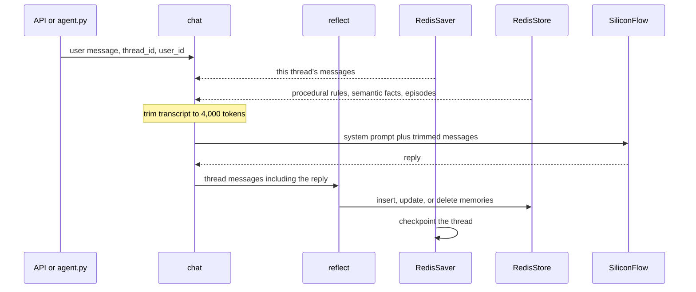
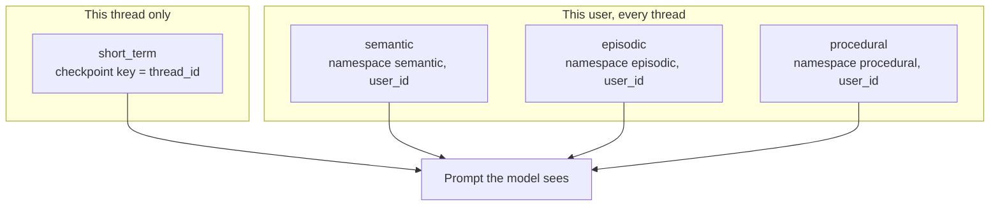

# LangMem Agent Demo

A demonstration of agent memory with LangMem, LangGraph, SiliconFlow for chat, Ollama for embeddings, and Redis for persistence.

| Memory | What it keeps | Where it lives | Scope |
| --- | --- | --- | --- |
| Short-term | The messages in the current thread | Checkpointer, keyed by `thread_id` | This thread only |
| Semantic | Durable facts such as name and display preference | `("semantic", user_id)` | Across threads |
| Episodic | A past situation, the reasoning, the action, and the result | `("episodic", user_id)` | Across threads |
| Procedural | Durable response rules such as teaching style and length | `("procedural", user_id)` | Across threads |

Short-term memory is LangGraph thread state, and it is the context the model sees. `RedisSaver` appends each turn to that thread, and the next turn on the same `thread_id` resumes from the saved messages. The chat node keeps the latest part of the transcript that fits 4,000 tokens. Semantic facts, episodes, and procedural rules each use their own store manager. The base system prompt stays in code. Procedural rules are inserted, updated, and deleted when the user gives or retracts behavioral feedback.

Each turn reads the thread transcript and the other memories, answers, then writes semantic, episodic, and procedural memories. A rule written on one turn is followed on the next turn.

## Prerequisites

- **uv**: Python package manager ([install guide](https://docs.astral.sh/uv/getting-started/installation/))
- **Ollama**: For local embeddings ([install guide](https://ollama.ai/download))
- **Redis 8**: For persistent memory (RedisJSON and RediSearch)
- **SiliconFlow API Key**: Get one from [SiliconFlow](https://cloud.siliconflow.cn/account/ak)

## Setup

1. **Install dependencies:**

   ```bash
   uv sync
   ```

2. **Start Redis and pull the embedding model:**

   ```bash
   docker compose up -d redis ollama
   docker compose up ollama-pull
   ```

   `ollama-pull` downloads `nomic-embed-text` (768 dimensions) and exits.

3. **Set the SiliconFlow API key** in `.env`:

   ```bash
   SILICONFLOW_API_KEY=your-api-key-here
   ```

   `.env.example` also lists `SILICONFLOW_BASE_URL`, `SILICONFLOW_MODEL`, and the optional `REDIS_URI` and `OLLAMA_BASE_URL` overrides. The default chat model is `deepseek-ai/DeepSeek-V3.2` on `https://api.siliconflow.cn/v1`.

## Run

Start the API and the chat page. Compose also starts Redis, Ollama, and the embedding pull when they are not already up:

```bash
docker compose up frontend
```

Open http://127.0.0.1:8080. The left side is the conversation. The right side shows this thread's short-term memory, plus the user's semantic, episodic, and procedural memory. The API is on http://127.0.0.1:8000 (`POST /api/chat`, `GET /api/memories`).

`agent.py` is still a local scripted run of the same graph:

```bash
uv run agent.py
```

The script plays three scenes for user `demo-user`:

1. **thread-a:** Alex prefers dark mode and asks what a binary tree is, mentioning family trees.
2. **thread-a:** The analogy worked. From now on, teach with analogies and keep answers short. This turn writes a procedural rule.
3. **thread-b:** Ask what a hash map is, given that Python dictionaries are familiar, and ask which display mode they prefer.

After each scene the script prints a memory board:

- Short-term memory shows this thread's messages. thread-b does not keep thread-a's transcript.
- Semantic memory keeps facts such as the name and dark-mode preference.
- Episodic memory keeps a reusable teaching episode when one was worth saving.
- Procedural memory lists response rules. Scene 3 follows the rule written in scene 2.

Run `uv run agent.py` a second time while Redis is still up. Semantic facts, episodes, and procedural rules are still in the store. Short-term transcripts stay on the thread id they were written under.

## Verify each memory

Extraction is done by the chat model, so the stored wording varies. A memory is working when the right panel (or `GET /api/memories`) gains the expected record, and a later turn uses it. Use a fresh `user_id` so leftovers from `demo-user` do not confuse the check. The page always uses `demo-user`; the curls below use `verify-user`.

```bash
curl -s http://127.0.0.1:8000/api/memories?thread_id=THREAD&user_id=verify-user
```

`short_term` is filtered to that thread. `semantic`, `episodic`, and `procedural` are filtered to that user.

### Short-term

Same thread resumes the transcript. A new thread does not.

1. On `thread-a`, send: `What is 17 + 25?`
2. On `thread-a`, send: `What two numbers did I just ask you to add?`
3. On `thread-b`, send the same follow-up.

`thread-a` answers 17 and 25. `thread-b` does not, because that transcript is a different checkpoint. `GET /api/memories?thread_id=thread-a` lists both turns under `short_term`; the same call for `thread-b` does not.

```bash
curl -s http://127.0.0.1:8000/api/chat \
  -H 'content-type: application/json' \
  -d '{"user_id":"verify-user","thread_id":"thread-a","message":"What is 17 + 25?"}'
```

### Semantic

Durable facts survive a new thread, and a correction replaces the old fact.

1. On `thread-a`, send: `I'm Sam. I prefer dark mode. I already know Python dictionaries.`
2. Read `semantic`. Expect an identity fact for Sam, a dark-mode preference, and knowledge of Python dictionaries.
3. On `thread-b`, send: `What's my name, and which display mode do I prefer?`
4. The reply says Sam and dark mode, even though `thread-b` has no earlier messages.
5. On `thread-b`, send: `I prefer light mode now.`
6. Read `semantic` again. The display preference is light mode. The dark-mode fact is updated or gone.

### Episodic

An episode is written after an approach is shown to work, then retrieved for a similar situation. Confirming one success is not a standing rule.

1. On `thread-a`, send: `Explain a stack by comparing it to a stack of plates.`
2. On `thread-a`, send: `That plate analogy worked. I understood it.`
3. Read `episodic`. Expect one episode whose observation, action, and result are about the plate analogy. A greeting such as `Hi` adds no episode.
4. On `thread-b`, send: `Explain a queue.`

The reply imitates the saved approach, usually another physical analogy, because the queue question retrieves that episode. The procedural list stays empty unless you also gave a standing instruction.

### Procedural

A standing instruction is stored as a rule, followed on the next turn and on other threads, and removed when retracted.

1. On `thread-a`, send: `From now on, teach with analogies and keep each answer to three sentences.`
2. Read `procedural`. Expect a rule whose instruction mentions analogies and short answers.
3. On `thread-b`, send: `What's a hash map?`
4. The reply is short and uses an analogy.
5. On `thread-b`, send: `Stop using analogies. Give plain definitions.`
6. Read `procedural`. The analogy rule is updated or deleted.
7. On `thread-b`, send: `What's a set?` The reply is a plain definition.

Dark mode and the user's name stay in semantic memory. They are not procedural rules.

### Persistence

Restart the agent process and leave Redis running (`docker compose restart agent`). Call `GET /api/memories` for the same `user_id` and `thread_id`:

- Semantic facts, episodes, and procedural rules are still there.
- That thread's short-term transcript is still there.
- A thread id you have not used is still empty for short-term memory.

## Architecture

The browser talks only to nginx. The agent process owns the graph, and Redis is the only durable store.

```mermaid
flowchart LR
  browser["Browser"] --> nginx["frontend<br/>nginx :8080"]
  nginx -->|"/"| page["Chat page"]
  nginx -->|"/api/"| api["agent<br/>FastAPI :8000"]
  script["agent.py"] --> graph["src.graph"]
  api --> graph
  graph --> saver["RedisSaver<br/>thread transcript"]
  graph --> store["RedisStore<br/>facts, episodes, rules"]
  saver --> redis["Redis 8"]
  store --> redis
  graph --> chatModel["SiliconFlow<br/>DeepSeek-V3.2"]
  store --> embed["Ollama<br/>nomic-embed-text"]
```

`frontend` serves the chat page and proxies `/api/` to `agent`. `src.api` keeps `RedisStore` and `RedisSaver` open for the process lifetime and serves `POST /api/chat` and `GET /api/memories`. `agent.py` runs the same compiled graph as a script. Chat calls SiliconFlow (`deepseek-ai/DeepSeek-V3.2`, override with `SILICONFLOW_MODEL`). Store search embeds the query with Ollama `nomic-embed-text` (768 dimensions, cosine).

### One turn

`src.graph` is two nodes. The checkpointer writes the new messages when the run finishes. `reflect` does not add a message.



1. `chat` loads the thread transcript, renders procedural, semantic, and episodic memory into the system prompt, trims the transcript, and calls the chat model.
2. `reflect` runs the three store managers on the full message list. Procedural memory can insert, update, or delete a rule. Semantic and episodic managers write only when the turn contains a fact or a reusable episode.

### Where each memory lives



| Module | Read on `chat` | Write on `reflect` |
| --- | --- | --- |
| `src.memory.short_term` | Latest transcript that fits 4,000 tokens | Checkpointer appends the turn; the module does not write the store |
| `src.memory.semantic` | Up to 5 facts, searched by the user text | Durable facts such as name and preference |
| `src.memory.episodic` | Up to 3 episodes, searched by the user text | A situation, the action, and the result |
| `src.memory.procedural` | The current rule text | Insert, update, or delete response rules |

The base system prompt stays in `src.graph`. Each store-backed module owns its schema, extraction instructions, namespace, manager, and rendering. A rule written on this turn is in the store for the next turn, including a turn on another `thread_id` for the same `user_id`.

How those store documents are embedded, written, and recalled is described in [docs/redis-memory.md](docs/redis-memory.md).

## Project goals

- [x] Persist short-term memory in Redis with a LangGraph checkpointer, and semantic, episodic, and procedural memory with LangMem
- [ ] Investigate Valkey compatibility as a Redis alternative
