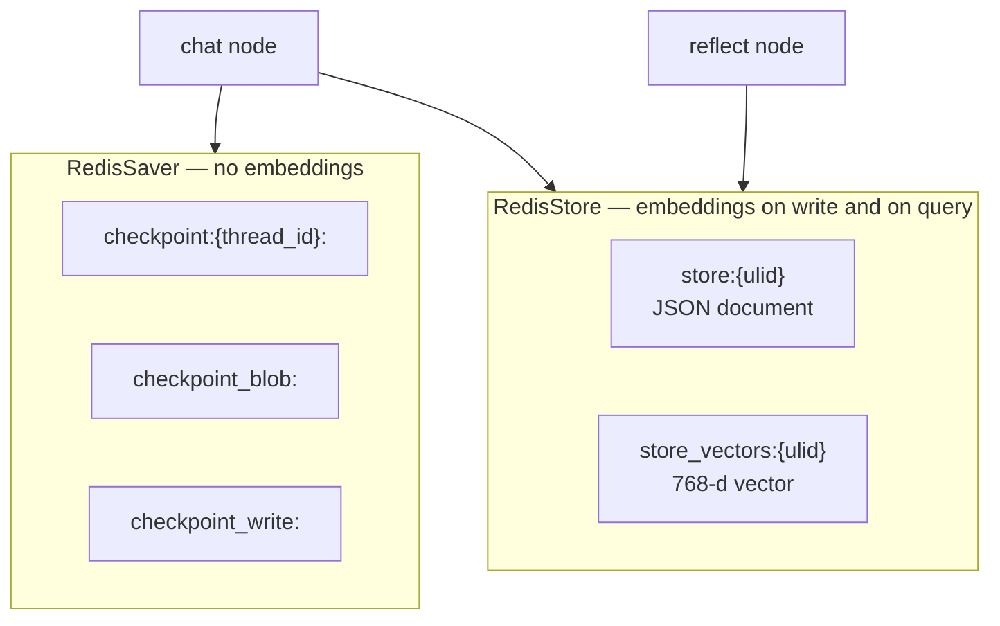
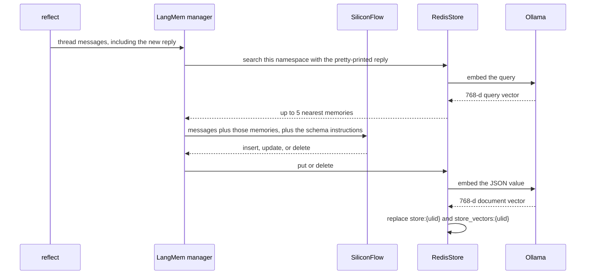
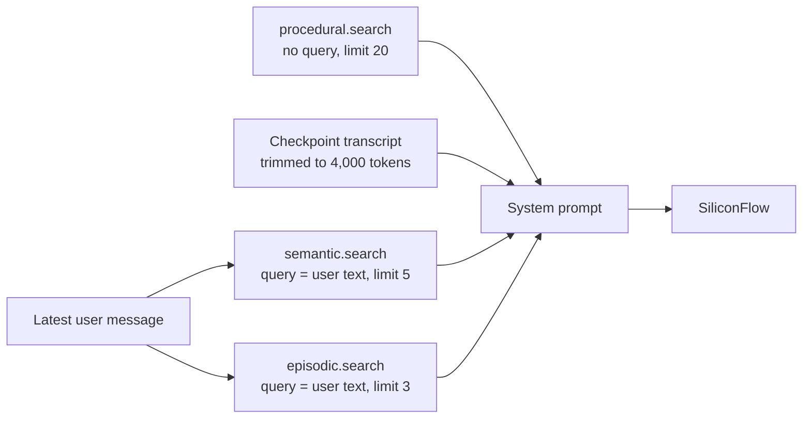

# How memories are stored in Redis and recalled

This note covers the three store-backed memories: semantic, episodic, and procedural. Short-term memory is the thread transcript in the LangGraph checkpointer. It is not embedded and is not searched by vector.

The chat model (SiliconFlow) decides what to write. The embedding model (Ollama) only turns text into vectors so Redis can rank memories by similarity.

## Two Redis roles

`src.runtime.open_runtime` opens both clients on the same Redis 8 instance (`REDIS_URI`, default `redis://localhost:6379`). Redis must provide RedisJSON and RediSearch. `setup()` creates the indexes if they are missing (`overwrite=False`).



| Role | Client | What it holds | How it is read |
| --- | --- | --- | --- |
| Thread transcript | `RedisSaver` | Every message of a `thread_id`, under `checkpoint`, `checkpoint_blob`, and `checkpoint_write` | The next turn on that `thread_id` loads the checkpoint. `short_term.messages_for_model` keeps the latest part that fits 4,000 tokens |
| Durable memory | `RedisStore` | One JSON document and one vector per semantic fact, episode, or procedural rule | `store.search`. A natural-language `query` uses the vector index. A search without `query` lists documents by namespace |

Restarting the agent process does not clear either side. Both live in the `redis_data` volume.

## Embedding model

```python
{
    "dims": 768,
    "embed": OllamaEmbeddings(model="nomic-embed-text", base_url=OLLAMA_BASE_URL),
    "distance_type": "cosine",
}
```

`OLLAMA_BASE_URL` defaults to `http://localhost:11434`. Inside Compose it is `http://ollama:11434`. The model is `nomic-embed-text`. The index is built for 768 float32 dimensions. A different embedding model, or a different dimension, will not match vectors already stored; the index has to be rebuilt and the memories rewritten.

`fields` is left unset, so LangGraph uses the default path `$`. That path embeds one string per memory: the whole JSON value, with keys sorted. It does not embed each schema field as its own vector.

The RediSearch vector field uses the FLAT algorithm and cosine distance. FLAT compares the query with every vector in the filtered namespace. There is no approximate index in this demo.

## What a memory looks like in Redis

LangMem writes this envelope. `kind` is the Pydantic model name. `content` is that model's fields.

| Kind | Namespace | `content` fields |
| --- | --- | --- |
| `SemanticFact` | `("semantic", user_id)` | `content`, `category` (`identity`, `preference`, `knowledge`, or `other`) |
| `Episode` | `("episodic", user_id)` | `observation`, `thoughts`, `action`, `result` |
| `Procedure` | `("procedural", user_id)` | `instruction`, `applies_when` |

`{user_id}` in the manager namespace is filled from `config["configurable"]["user_id"]`. A search for one user does not see another user's namespace.

Example for user `demo-user`:

```json
{
  "prefix": "semantic.demo-user",
  "key": "a1b2c3d4e5f64789a0b1c2d3e4f56789",
  "value": {
    "kind": "SemanticFact",
    "content": {
      "content": "The user prefers dark mode.",
      "category": "preference"
    }
  },
  "created_at": 1730000000000000,
  "updated_at": 1730000000000000
}
```

That document is stored as RedisJSON at `store:{ulid}`. The ULID is a new storage id on every write. It is not the memory id. The memory id is `key`.

The vector document is stored at `store_vectors:{same ulid}`:

```json
{
  "prefix": "semantic.demo-user",
  "key": "a1b2c3d4e5f64789a0b1c2d3e4f56789",
  "field_name": "$",
  "embedding": [0.01, -0.02],
  "created_at": 1730000000.0,
  "updated_at": 1730000000.0
}
```

`embedding` is 768 floats. The snippet above is shortened. `field_name` is `$` because the whole value was embedded. Document timestamps are microseconds. Vector timestamps are seconds. Both indexes are RediSearch indexes named `store` and `store_vectors`.

`prefix` is the namespace joined with `.` and escaped for RediSearch. The search filter is `@prefix:{namespace}*`, so `("semantic", "demo-user")` only hits keys whose prefix starts with that namespace.

## Write path

`reflect` calls each manager with the thread messages. The manager does not receive a hand-written embedding. `store.put` embeds the value on the way in.



Steps inside `create_memory_store_manager` (`query_model` is not set, `query_limit` stays 5):

1. Build search queries with `get_dialated_windows(messages, query_limit // 4)`. `5 // 4` is 1, so there is one query: the LangChain pretty-print of the last message. `reflect` runs after `chat` has appended the reply, so this query is the assistant reply, not the user utterance.
2. `store.search(namespace, query=that text, limit=5)`. Redis embeds the query, runs a cosine search inside the namespace, and returns the nearest documents.
3. Sort by score, highest first, and keep 5. The score LangGraph exposes is cosine similarity: RediSearch returns cosine distance, and the store converts it with `1 - distance`. A higher score is a closer memory.
4. Give those memories to the chat model together with the module instructions (`SemanticFact`, `Episode`, or `Procedure`).
5. Apply the model's tool calls:
   - A new memory is `put` under the namespace. Its `key` is the id from the extraction result.
   - An update `put`s the same namespace and `key` when `kind` or `content` changed.
   - A delete calls `store.delete`. Semantic and procedural managers allow deletes. The episodic manager does not (`enable_deletes=False`).

`put` of an existing `(namespace, key)` deletes the old `store:` document and the old `store_vectors:` document, then writes a new ULID for both. The vector is recomputed from the new JSON. A memory that did not change is not written again.

`src.runtime._patch_store_delete` escapes `-` in keys before delete. RediSearch treats a bare hyphen in a tag query as an operator, so an unescaped UUID-shaped key would miss the document and leave it in the index.

## Recall path

Recall for the answer happens in `chat`, before the model is called. It is separate from the search inside `reflect`.



| Memory | Call | Uses the embedding? | What the model receives |
| --- | --- | --- | --- |
| Short-term | Checkpoint for `thread_id`, then `trim_messages` | No | The latest messages that fit 4,000 tokens |
| Semantic | `store.search(("semantic", user_id), query=user_text, limit=5)` | Yes. The user text is the query | Up to 5 facts, as JSON |
| Episodic | `store.search(("episodic", user_id), query=user_text, limit=3)` | Yes. The user text is the query | Up to 3 episodes, rendered as When / Thought / Did / Result |
| Procedural | `store.search(("procedural", user_id), limit=20)` | No. There is no `query`, so Redis lists documents on the `store` index | Every remaining rule, as `instruction (when: applies_when)` |

Semantic and episodic recall embed only the current user utterance, not the whole thread. A later question about hash maps can still surface a plate-stack episode when the two texts are close in the embedding space. The namespace filter runs before similarity, so another user's vectors are not compared.

Procedural rules are few and are meant to be followed as a set, so they are listed rather than ranked. The same non-vector search is used when the UI calls `GET /api/memories`: `memory_board` searches each kind prefix with a limit of 50 and does not pass a query.

Empty semantic or episodic namespaces return no items. The prompt then contains `(empty)` for that section. The base instructions in `src.graph` stay in the prompt either way.

## What the chat model is allowed to keep

The embedding does not decide whether something is a memory. The chat model does, using the instructions on each module:

- Semantic: durable identity, preferences, and background. Skip the current task and instructions about how to respond. Update a corrected fact and delete a contradicted one.
- Episodic: one episode only when the exchange shows a reusable situation, action, and outcome. Greetings and bare preferences are skipped. Deletes are disabled.
- Procedural: standing instructions about style, teaching, format, and procedure. Update a revised rule and delete a retracted one. Identity and one-off episodes are skipped.

After extraction, semantic memory drops notes that say nothing was learned (`drop_meta`). Procedural memory drops the same kind of empty rule, and deletes a leftover `instructions` key from an older build. Those cleanups use a non-vector `store.search`.

A rule written in `reflect` is visible on the next turn, including a turn on another `thread_id` for the same `user_id`. It is not injected back into the prompt of the turn that wrote it. `chat` already ran.
